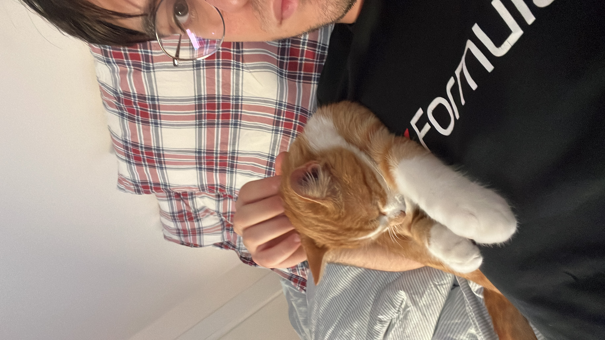

I am a PhD Candidate at Scuola Normale Superiore di Pisa. My PhD is part of the HuME PhD, joint with IUSS Pavia and University of Milan.  

My PhD Supervisor is Mario Piazza. My PhD Co-Supervisor is Achille Varzi.

I was a visiting scholar in New York City during the Spring Semester 2025, at CUNY Graduate Center, under the supervision of Graham Priest.

I work primarily in metaphysics and philosophical logic.

Specifically, my research focuses on modality and persistence. I have written a PhD thesis on Actualist Five-dimensionalism: a theory that combines the view the only the actual world exists with the view that ordinary objects are five-dimensional entities extended across possible worlds.

I am a football fan (I unfortunately support Udinese), and also a Formula1 fan (I unfortunately support Ferrari).

I have an orange cat named <button class="macbeth-trigger" type="button" aria-expanded="false">Macbeth</button>.

